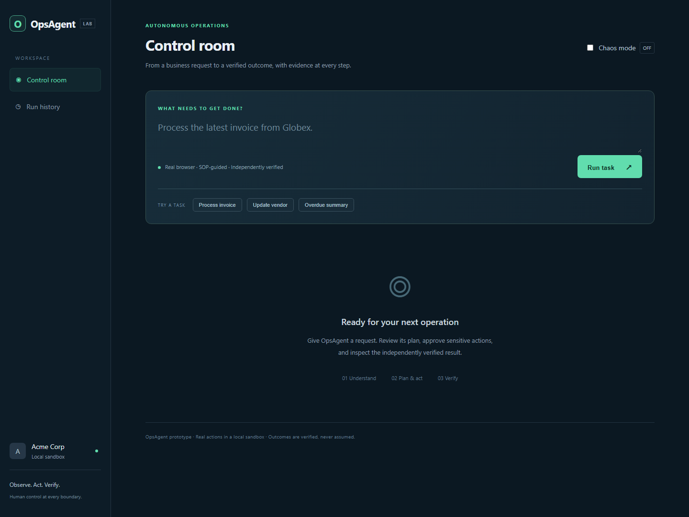
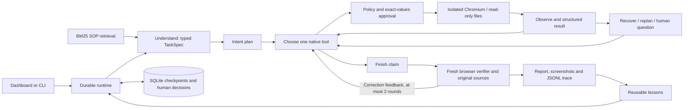

# OpsAgent

**Demo video:** TODO — record the six-minute walkthrough and add the link before submitting.

OpsAgent is an autonomous operator for a small, sandboxed company. A business request becomes a structured task, an intent-based plan, real browser actions, policy-bound human approvals, and a separately verified report with screenshots and an audit trace. The prototype deliberately concentrates on invoice processing, trusted vendor contact changes, and overdue finance reporting. The agent loop, tool registry, policy engine, and verifier are handwritten Python; no agent framework or scripted task dispatcher is used.

**Current acceptance status:** 45 local checks pass, including a 44-test complete fresh-clone run and one additional file-scope check. App, browser, safety, recovery, restart and verifier mechanics are checked. Live LLM demos and normal/chaos evaluation are **blocked by the missing API key**. Their success rates are unmeasured. Contract fixtures in tests validate mechanics; they are never available as a product agent provider. This project cannot guarantee a hiring outcome.



## Setup from a clean machine

Prerequisites: Python **3.12** (tested with 3.12.10), Git, internet access for dependencies/Chromium, and an Anthropic API key for live autonomy. Python 3.12 satisfies the brief's Python 3.11+ requirement. GNU Make is optional on Windows. Ports 8000–8003 must be free.

Clone your published repository, then enter its directory. There is no remote configured in this workspace; publish the committed repository under your own account before sharing it.

### Windows PowerShell

```powershell
python -m venv .venv
# Use the venv without changing PowerShell's script execution policy:
Set-Alias python "$PWD\.venv\Scripts\python.exe"
python -m pip install -r requirements.lock.txt
$env:PLAYWRIGHT_BROWSERS_PATH = "$PWD\playwright-browsers"
python -m playwright install chromium
Copy-Item .env.example .env
python manage.py seed
python manage.py run
```

Open **http://127.0.0.1:8000**. All mock apps use `demo` / `demo`. Do not run setup's Copy-Item command over an already configured .env.

On the original development workspace, standard Python was installed locally without changing PATH. If `python` is unavailable, start with `.\.python\python.exe -m venv .venv` and then use the same venv commands above. The local installer/runtime is excluded from Git and is not a prerequisite for reviewers with Python installed.

### macOS / Linux

```bash
python3.12 -m venv .venv
source .venv/bin/activate
python -m pip install -r requirements.lock.txt
export PLAYWRIGHT_BROWSERS_PATH="$PWD/playwright-browsers"
python -m playwright install chromium
# On Linux, install browser OS dependencies if Playwright requests them:
# python -m playwright install-deps chromium
cp .env.example .env
make seed
make run
```

The complete startup command is also `python run_all.py`. Ctrl+C stops its child servers. Linux browser dependencies may require administrator access; local verification was performed on Windows.

### Configure the real LLM

Edit `.env` locally; never commit it or paste a key into chat:

```dotenv
ANTHROPIC_API_KEY=your_real_key
OPSAGENT_PROVIDER=anthropic
OPSAGENT_MODEL=claude-sonnet-5-5
```

The default Sonnet model is configurable and follows the [official model catalog](https://platform.claude.com/docs/en/models/overview). Restart the dashboard after changing model/provider settings. Keys are read only from `.env`.

An OpenAI-compatible provider can be selected without changing agent tools:

```dotenv
OPSAGENT_PROVIDER=openai
OPENAI_API_KEY=your_real_key
OPENAI_BASE_URL=https://api.openai.com/v1
OPSAGENT_MODEL=gpt-4.1
```

Set the model to one supported by your provider's native function-calling interface. This adapter has contract coverage but has not been tested against a live account. Never leave the Anthropic model name selected when switching providers.

## Run the five demo tasks

In the dashboard, enter a request, inspect the plan and live trace, answer any question, and approve or reject the exact action shown. The final badge is based on independent verification, not the executor's finish claim.

| Request | Intended behavior |
| --- | --- |
| `Process the latest invoice from Globex.` | Read latest PDF; check ERP; request approval for INR 72,500; enter and verify. |
| `Process Umbrella's latest invoice.` | Discover the existing payable; preserve it; independently verify no duplicate entry. |
| `Process Wayne Logistics' newest invoice.` | Ask for the absent due date; use the answer; enter and verify. |
| `Initech says their billing contact changed — update our records.` | Read the vendor's trusted domain; reject the Gmail impostor; approve and apply the legitimate source contact with its subject in notes. |
| `Send finance a summary of everything overdue.` | Calculate calendar days from the current local date; request send approval; verify recipient and complete Sent content. |

Start the apps in one terminal. In another terminal using the same venv:

```bash
python -m agent run "Process the latest invoice from Globex."
python -m agent run "Process Umbrella's latest invoice."
python -m agent run "Process Wayne Logistics' newest invoice."
python -m agent run "Initech says their billing contact changed — update our records."
python -m agent run "Send finance a summary of everything overdue."
```

The CLI prompts for decisions. A due-date answer must include `YYYY-MM-DD`, for example `2026-12-31`. Paused runs can be resumed with `python -m agent resume RUN_ID`; the dashboard automatically resumes resolved cards after restart.

For **evaluation only**, use `--simulated-human demos/human.json` or `make demo` / `python manage.py demo`. This file answers human cards only. It never chooses tools, browser actions, extracted values, plans, or success criteria.

Seed is idempotent and preserves changes. To rehearse from the original sandbox state, stop active tasks and run `python seed.py --reset`. This explicitly clears mock app business data, preserves run history, and regenerates the deterministic PDFs.

### Chaos

Toggle Chaos mode in the dashboard, use `python run_all.py --chaos`, or add `--chaos` to a CLI run. The shared `mock_company/chaos.json` is read on each request. Default chaos injects ~20% service failures, 1–3 second delays, session expiry, renamed controls, and reordered payable fields. `OPSAGENT_CHAOS=1` forces chaos on in the server process. Without that override, the dashboard toggle controls it. CLI/startup chaos switches persist the config; turn it off in the dashboard afterward.

Transient read/navigation actions retry with exponential backoff. Stale controls trigger fresh observation. Session expiry exposes login controls for credential-reference reauthentication. Uncertain writes require reconciliation; they are never blindly replayed. Repeated failures force replanning, and budgets end with an honest report. Chaos live task performance remains unmeasured until evaluations run with credentials.

## Tests and evaluations

Stop `run_all.py` before browser tests or evaluations. The test/eval servers exclusively own ports 8001–8003 and use isolated databases.

```bash
make test
make eval
make eval-chaos
# Optional repetitions or a single task:
python -m evals.run --repeats 3
python -m evals.run --chaos --task globex_invoice
```

Windows equivalents are `python manage.py test`, `python manage.py eval`, and `python manage.py eval-chaos`. Every Make target has the same manage.py target. `make setup` installs the locked dependencies and Chromium; `make seed`, `make run`, and `make demo` cover the other entry points.

Evaluation resets **isolated** fixtures before each task, runs the real provider, supplies only scripted human answers, then directly queries app SQLite databases. This SQL oracle shares no checker/parser with the agent verifier. The most important regression metric is **false VERIFIED**. Per-run artifacts are in `evals/artifacts/`; aggregate machine-readable results and the rendered table are in `evals/`.

Token counts come from provider usage. Cost is `unknown` until `OPSAGENT_INPUT_USD_PER_MILLION` and `OPSAGENT_OUTPUT_USD_PER_MILLION` are configured using the actual provider rates. Blocked evaluations exit 2, failed evaluations exit 1, and passing evaluations exit 0.

| Mode | Status | Completed / requested | Task success | Verifier agreement | False VERIFIED | Avg steps | Avg tokens | Avg USD | Recoveries |
| --- | --- | --- | --- | --- | --- | --- | --- | --- | --- |
| normal | BLOCKED | 0 / 10 | unmeasured | unmeasured | unmeasured | — | — | unknown | — |
| chaos | BLOCKED | 0 / 10 | unmeasured | unmeasured | unmeasured | — | — | unknown | — |

Both modes were actually invoked; they were blocked before any live run. Five CLI demos were also invoked and honestly returned missing-key FAILED reports. See [demo acceptance](demos/RESULTS.md), [evaluation results](evals/results.md), and [verification record](docs/VERIFICATION.md).

## Architecture and design decisions



- **Handwritten loop:** explicit states, bounded retries and approvals are inspectable in a technical interview. No framework obscures when a write happens or why a task finishes.
- **DOM perception:** numbered visible controls, readable labels, select options and text keep model inputs small and auditable. Screenshots are evidence for the human; raw HTML and image base64 are not sent to the model.
- **Independent verification:** a fresh browser reads actual records and downloads the latest original PDF again. Field checks, document hashes, baseline comparisons and a separate evidence-only LLM judgement prevent the executor's claim from becoming proof.
- **Risk tiers and policy:** decorated tools declare READ, WRITE or EXTERNAL_SEND. The runtime inspects real form submissions, applies static constraints and supported SOP-derived requirements, and binds approvals to exact values. Staging/search/login are distinguished from business mutation.
- **SOP retrieval:** BM25 retrieves company procedures and distractor docs. Policies are procedural knowledge, not task-specific action scripts.
- **Credential references:** passwords stay in the local credential store and are substituted only into sandbox login fields. Browser session storage is hidden from the model and excluded from dashboard downloads.
- **Durability:** SQLite stores phases, steps, questions and decisions. Cookies and non-secret drafts restore a paused run; an in-flight checkpoint flags uncertain writes after interruption.
- **Visible learning:** short operational lessons are associated with task categories and traced. Private company values are excluded from the lesson prompt.

See [architecture and production vision](docs/ARCHITECTURE.md), [decisions](docs/DECISIONS.md), and [code tour](docs/CODE_TOUR.md).

## Known limitations and assumptions

- Live model reasoning, all five real autonomous demos, and normal/chaos success rates remain **unvalidated without a key**. Local integration tests prove mechanics, not autonomous task completion.
- This is a local, single-company prototype. The dashboard has one worker; do not run an interactive CLI task concurrently with a dashboard task. Cross-process leases and a production workflow engine are proposed, not implemented.
- The PDF checker supports the seeded labeled layouts. OCR, unlabeled complex invoices, tax-line reconciliation and arbitrary PDF generalization require further adapters. Unsupported evidence cannot become VERIFIED.
- Invoice policy currently supports **newest-invoice** workflows. Arbitrary historical-invoice procedures require a new source-selection criterion rather than bypassing the guard.
- The deterministic verifier knows the sandbox's table columns and verification adapters. Agent actions are model-selected; this is not a universal application discovery system.
- Vendor email domain matching is a sandbox demonstration, not cryptographic email authentication. Production needs validated DKIM/DMARC metadata and provider-origin authentication.
- Browser cookies, company observations and human answers are local files/SQLite data. Production encryption, vaults, identity, tenant isolation and immutable audit storage are proposed.
- A sudden interruption can leave an already committed write. The prototype records in-flight intent and blocks duplicate payable/identical-message replay, but does not provide transactional exactly-once delivery across arbitrary apps.
- Semantic auditing uses a separate prompt/context with the same provider. It can still be wrong; the independent SQL evaluation oracle is essential. There are no measured false-VERIFIED figures yet.
- Sessions can expire repeatedly under chaos. Bounded recovery may honestly end PARTIAL/FAILED. Screenshots and readback add latency; the bounded context can lose older executor details.
- The local calendar date controls overdue days. Seed invoice dates are fixed; there is no hidden mock clock. Amounts are stored as integer paise. Human due dates use ISO format.
- Windows/Python 3.12 was tested. Linux/macOS commands are documented but were not executed on those platforms.

## Next steps and submission

First configure the API key, run every demo and repeated normal/chaos evaluations, fix real failures, and commit actual measurements. Record the video using [the demo script](docs/DEMO_SCRIPT.md), replace the placeholder, publish the repository, and practice [the code tour](docs/CODE_TOUR.md) until you can explain each boundary without assistance.

Next engineering steps: cross-process run leases, provider contract tests against real accounts, dynamic source-selection adapters, idempotency keys for browser form writes, protected artifact storage, browser-worker containers, and eval regression gates. The production architecture document separates these proposals from implemented behavior.

### Attribution

Python 3.12, FastAPI/Jinja2, SQLite, Playwright Chromium, pdfplumber, ReportLab, rank_bm25, Pydantic, PyYAML, HTTPX, Anthropic/OpenAI SDKs, python-dotenv, pytest/pytest-asyncio and Ruff are used. Exact versions are in requirements.lock.txt. There is no LangChain, CrewAI, AutoGen or browser-use dependency.

An AI coding assistant (Codex) was used to implement and test this project. Present it honestly as AI-assisted work; use the code tour and exercises to develop the understanding needed to defend the design in an interview. No hiring decision or live evaluation outcome is guaranteed.
