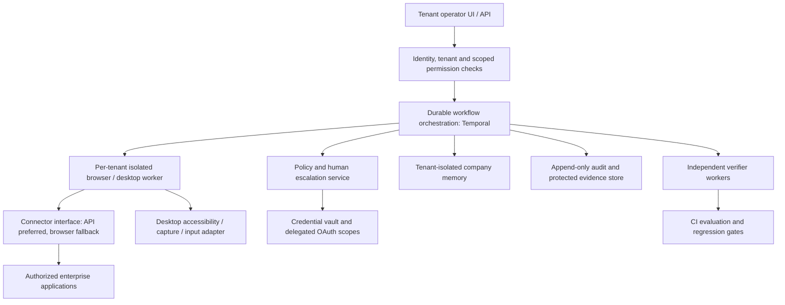

# Architecture: implemented prototype and production direction

## Implemented boundaries

The prototype is one tenant, one local sandbox, and one dashboard worker. `run_all.py` starts the vendor portal, ERP, mail and dashboard. Each app has a separate SQLite database, signed cookie session and CSRF-protected HTML forms. There are no direct app API tools for the executor. Evaluation alone reads app databases as an independent oracle.

A Runtime owns an isolated Chromium context and a run workspace. It retrieves SOPs with BM25, obtains a Pydantic TaskSpec through native tool calling, obtains an ordered plan, then selects one registered tool per iteration. Recent actions are compressed by keeping a bounded window; the explicit scratchpad and human decisions remain in the next model input. Numbered observations describe real visible DOM controls and save screenshots.

The policy boundary distinguishes local field staging from submission. Before mutation it inspects the DOM form's current values, independently reads relevant records and source messages, and evaluates static configuration plus supported TaskSpec policy requirements. High-value payables, vendor changes and sends produce durable exact-values approval cards. Rejections persist. Unknown writes require approval; unknown mutation forms are denied.

`finish` only triggers a verifier. A new browser context reads all relevant state and original documents. Deterministic predicates compare fields, original PDF hashes, approved values, human date answers and initial baselines. A separate model judgement receives the original request, fixed criteria and fresh evidence only. It receives no executor history, claimed values or scratchpad. Failed checks feed at most two correction rounds back into execution. Unavailable evidence produces PARTIAL, never an assumed success.

Checkpoints precede business submissions. A restart restores signed browser state and non-secret draft fields; in-flight intent becomes a reconciliation warning. Uncertain writes are not blindly retried. Unique payable constraints and matching-Sent checks provide limited deduplication. This is not an arbitrary-app exactly-once transaction protocol.

Run lifecycle and audit state live in SQLite (`runs`, `steps`, `approvals`, `questions`, `lessons`). Trace JSONL and evidence files are exportable. A paused run releases its browser and survives a process restart. The dashboard requeues interrupted work and resolved cards. Wall time excludes human waiting. Default execution budget is 60 tool iterations and 900 active seconds.

## Proposed production architecture

The following design is **proposed**, not present in this repository.

### Worker isolation and desktop control

Assign one ephemeral container or VM to each tenant/session, with an isolated browser profile, filesystem, network policy and resource quota. Use containers for browser-only workloads and VMs for desktop applications requiring OS sessions. Never reuse browser contexts across tenants. Restrict egress to authorized destinations and deny private infrastructure/metadata endpoints.

A desktop adapter should expose observation and action contracts comparable to the browser registry: accessible control descriptions where available, scoped screenshots, and explicit keyboard/pointer operations when accessibility APIs fail. It should report unavailable controls, focus errors and state changes. Pixel coordinates require freshness and confidence checks; the prototype has no desktop control path.

### Durable workflows and connectors

Temporal would own long-running task history, activity retries, approval waits, cancellation and resumable checkpoints. Browser workers should execute short leased activities with heartbeats. Every side effect carries a stable operation ID, evidence hash and idempotency key where the destination supports it. On ambiguous timeouts, reconcile receipts/state rather than retrying a send or financial action.

Define a connector contract for observe, read, prepare mutation, submit and independently read back. Prefer first-party APIs for reliable structured writes, permissions and idempotency; use browser/desktop automation when no suitable API exists. Keep intent and policies independent of transport. The present prototype intentionally uses browser forms to demonstrate operator behavior; it does not implement this connector layer.

### Identity, secrets and permissions

Replace the sandbox credential dictionary with a vault storing delegated credentials or short-lived OAuth tokens. Give each AI employee narrowly scoped tenant/app/task permissions. The model receives credential handles, never secret values. Perform substitution only inside authenticated workers, redact exports, rotate tokens and revoke access when an employee/task is disabled. Approval identity must bind to a real manager with authorization for the amount or action.

The prototype's domain check trusts sandbox sender fields. Production mail connectors must validate sender provenance and email authentication rather than rely on body text or a displayed From string.

### Company memory and tenant isolation

Index SOPs by tenant, document version, provenance and effective date. Record retrieved passages and their versions in each plan. Extend memory to learned procedures from human demonstrations, outcome feedback and approved corrections. Learned procedures are suggestions with confidence and provenance; they cannot loosen policy or become executable instructions without validation.

Use tenant identifiers in every query and storage key, separate encryption keys and access controls, and evaluate cross-tenant leakage. Prefer versioned retrieval snapshots so a long-running task can detect policy changes. The prototype has BM25 SOP retrieval and short task-type lessons, but no demonstration learning or multi-tenant isolation.

### Audit design and human escalation

Store append-only events with run/task/tenant/actor/operation identifiers, timestamps, model/version, schema version, tool arguments, policy decision, evidence digest, actual result and usage. Separate immutable audit metadata from sensitive screenshots/document blobs with retention rules. Add integrity chaining or signed manifests and explicit redaction for exported traces. Correlate provider request IDs with activity IDs.

Approval cards must show exact destination, amount, fields, source and policy citation. Grant approval only to that immutable payload and expiry window; invalidate it if values, source or policy change. Escalate on missing required input, conflicting policies, uncertain writes, repeated recovery, unsupported evidence or budget exhaustion. Allow humans to reject, supply information or take over in a supervised session. The prototype implements exact-action fingerprints, durable decisions and question cards; real identity, policy versioning and takeover are proposed.

### Evals, reliability, cost and latency

Run a seeded, reproducible environment as a CI service. Evaluate normal operation, shifted wording, vendors unseen during development, multi-page lists, unsupported documents, phishing, rejection, repeated auth expiry, delayed/ambiguous writes and provider failures. Keep SQL/API ground truth independent of the agent verifier. Gate releases on zero false VERIFIED outcomes in the regression suite, then monitor successful task completion and safe-failure rates separately. A finite suite cannot establish a universal reliability guarantee.

Record provider tokens, configured rates, wall time, browser observations and recoveries. Control costs with narrow criteria, compact observations, cached/versioned retrieval, read-only connector APIs, bounded correction loops and appropriate model routing. Avoid redundant readback only when an authenticated receipt plus a subsequent state check provides equivalent evidence. Cost optimization must preserve independent verification. Live metrics in this repository are currently unmeasured because no key is configured.

### Failure modes and security threats

| Threat / failure | Prototype behavior | Proposed production mitigation |
| --- | --- | --- |
| Prompt injection in email/web/PDF | System treats content as data; real vendor-domain checks and approval prevent the seeded impostor update. | Provenance labels, instruction/data separation, allowlisted capabilities, authenticated sender metadata, injection regression tests and supervised high-risk actions. |
| Model fabricates completion | Fresh-browser deterministic checks and separate evidence-only judgement. | Connector receipts, independent worker identities, measured verifier calibration and explicit unknown states. |
| Duplicate or uncertain write | Pre-submit checks, unique payable constraint, Sent match guard, in-flight checkpoint. | Stable operation IDs, destination idempotency keys, reconciliation workflows and leases. |
| Session or UI drift | Bounded retries, re-observation, opaque-credential login, replanning. | Versioned connector contracts, drift canaries and supervised fallback. |
| Missing/conflicting source data | Ask a human or fail/return PARTIAL. | Versioned evidence, policy conflict resolver and data-quality escalation. |
| Concurrent state changes | Single dashboard worker and baseline comparisons. CLI concurrency is unsupported. | Cross-process leases, isolation, source/version preconditions and concurrency-aware verification. |
| Credential/artifact leakage | Secret cookie file hidden from tools and dashboard downloads; .env excluded from Git. | Vaults, encryption, scoped authorization, redaction, retention controls and DLP. |
| Cross-tenant leakage / SSRF | One tenant and strict local origin routing. | Tenant-isolated profiles, namespaces, network controls and tested egress policy. |
| Hostile downloads / browser compromise | Only sandbox document links are downloadable. | File scanning, content-type/size limits, isolated workers and patch management. |
| Approval replay or policy change | Exact-values fingerprint and durable rejection. | Actor authorization, expiry, one-use receipts and policy-version binding. |

Production readiness would require real credentialed evals, stronger concurrency and idempotency, threat-model testing, operational monitoring and an incident/rollback procedure. Those are deliberate next milestones, not claims about the current prototype.
